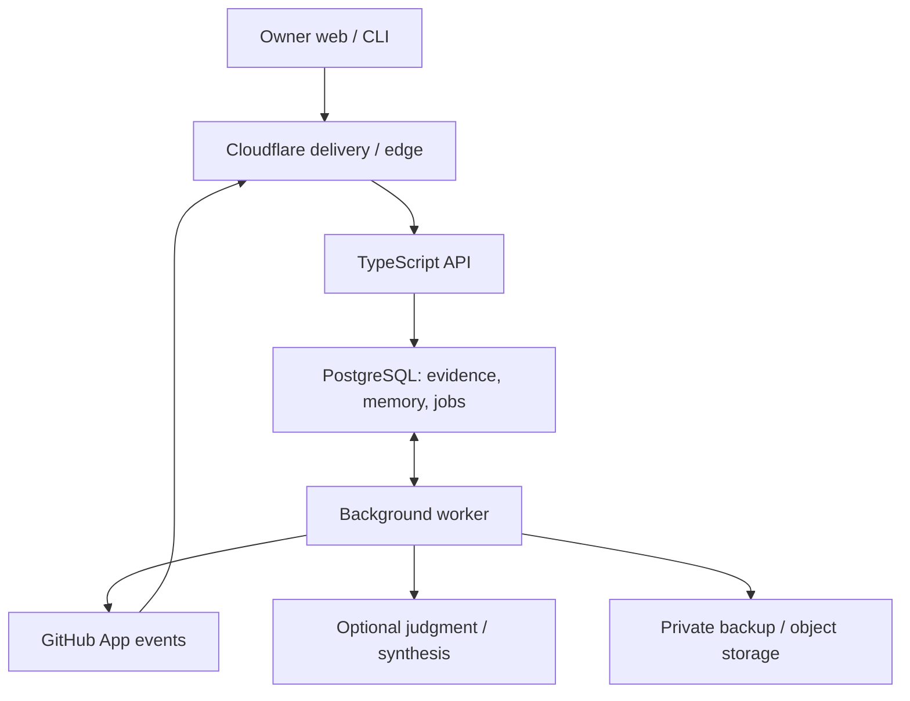

# Nucleus Next — Canonical Product Requirements

Version: 1.0 · Authored: 2026-10-14 · Status: proposed for owner approval through this pull request

Repository: `nrsandoval1231-oss/nucleus-next` · Canonical location: `docs/PRD.md`

**Protect the vision. Preserve the knowledge. Verify the progress. Eliminate the clutter.**

This is the sole product specification. It establishes a fresh foundation; it does not inherit the previous Nucleus personal operating system, runtime, or code. README is orientation only. This document authorizes no deployment or repository mutations by the future product. Approval of this PRD establishes product intent; it does not approve inferred vision contracts for connected projects.

Normative language: **MUST** is a release requirement; **SHOULD** permits a documented engineering exception that preserves outcomes. **Proposed default** is an executable initial choice, not an empirically validated threshold. Defaults are versioned configuration, not magic constants. Changes to protected boundaries require owner approval. Framework, ORM, parser, and packaging details remain engineering choices within these constraints.

## 1. Executive product definition

Nucleus Next is a live GitHub portfolio intelligence and persistent engineering memory platform. It connects engineering evidence to approved project intent and makes an entire software portfolio understandable after an interruption of days or months.

The primary user is an owner building several products with human developers and autonomous engineering systems. Developers and coding agents consume bounded, source-grounded context. The initial product supports one owner-controlled workspace with multiple repositories and repository-scoped read credentials for integrations. Multi-customer billing, public sharing, enterprise role hierarchies, and team collaboration are excluded from the first complete release. Data isolation is required from inception.

Five capabilities define the product: Vision Guardian, Project DNA, Agent Observatory, Repo Guardian, and Time Machine. None requires a generative model. Optional judgment and synthesis improve interpretation without becoming authoritative or blocking evidence ingestion.

The product is successful when the owner can resume a project with its approved direction intact, identify the next evidence-backed action, and distinguish actual delivery from activity without manually auditing many GitHub pages.

## 2. Problem statement and user outcomes

Engineering activity is scattered across branches, pull requests, checks, documentation, and conversations. Reported completion often lacks reproducible evidence. Decisions disappear into chats, competing plans accumulate, and active coding can drift from the intended product.

| User outcome | Required behavior | How to measure |
|---|---|---|
| Resume a project quickly | Show approved vision, current state, blockers, governing decisions and next action with evidence | In a representative task, owner identifies these five items within 2 minutes |
| Protect intent | Preserve owner-approved contracts and surface contradictory changes | All authority/lineage scenarios in §16 pass |
| Trust progress | Separate code, verification, merge, release, deployment and acceptance | Zero unsupported completion claims in the acceptance corpus |
| Reduce investigation | Explain alerts and link exact evidence | Owner can resolve why an alert exists without another repository audit |
| Reduce clutter safely | Identify competing authorities and actionable cleanup candidates | Reviewed findings record accepted, dismissed and unsafe recommendations |
| Preserve institutional knowledge | Retain evidence, historical decisions and portable exports | Restore and export/import drills reconstruct identical protected state |

The 2-minute outcome is a proposed usability target, not a measured result. Record baseline versus Nucleus-assisted resumption time on at least five varied projects. Do not claim business impact from faster page loading alone. Counts of commits, files, tokens or stored memories are not success metrics.

## 3. Principles, scope and non-goals

1. **Authority is separate from confidence.** Owner approval governs intent; GitHub observations govern repository facts; neither substitutes for the other.
2. **Evidence before inference.** Every state or recommendation exposes provenance, scope, freshness and uncertainty.
3. **Code first.** Explicit rules, state machines, graph traversal and structured retrieval handle answerable questions.
4. **Missing is a real state.** Inaccessible, pending, stale, failed and successful are different outcomes.
5. **Memory is centralized and portable.** No recurring `MEMORY.md` or `VISION.md` files in connected repositories.
6. **Read-only GitHub.** The product cannot commit, delete, open PRs, post comments/checks, merge, run workflows or deploy. Downloadable proposed diffs have no execution capability.
7. **Lean repositories, sufficient structure.** Preserve tests, migrations, necessary source modules, licenses, reproducibility and evidence. A low file count is not a quality goal.
8. **Explainable adaptation.** Version policies, retain outcomes, replay proposals and require owner approval for promotion.

Nucleus does not replace GitHub, execute coding agents, manage trading, duplicate issue tracking, deploy applications, store universal personal knowledge, or produce a factory of documents. Orloom owns autonomous engineering; Recall owns broader personal and organizational knowledge; Argus owns research intelligence. Nucleus consumes references and returns context without assuming those products' responsibilities.

## 4. Functional requirements and common contracts

| ID | Capability | Required result |
|---|---|---|
| F01 | Connection and portfolio | Install/select repositories, show coverage, freshness, active work, attention and disconnected state |
| F02 | Vision Guardian | Versioned owner-approved contracts, protected decisions, drift review and lineage (§5) |
| F03 | Project DNA | Evidence-backed identity, components, dependencies, conventions, limitations, milestones and project relationships |
| F04 | Agent Observatory | Commits, refs, PRs, reviews, checks, merges, releases, deployments and engineering episodes |
| F05 | Persistent memory | Six logical layers, temporal reconciliation and consolidation (§6) |
| F06 | Deterministic intelligence | Explainable regimes, blockers, dependencies, priorities and policy replay (§7) |
| F07 | Repo Guardian | Canonical file inventory and risk-classified hygiene findings (§9) |
| F08 | Continuity | Task-scoped CLI/API context with authority, evidence and uncertainties (§10) |
| F09 | Ask Nucleus | Deterministic question templates and search; optional cited synthesis |
| F10 | Time Machine | Historical belief and retrospective state, comparisons and provenance (§6) |
| F11 | Portability and recovery | Owner export, isolated restore, readable knowledge and tested recovery (§15) |
| F12 | Controlled learning | Outcome recording, qualified lesson suggestions and gated policy promotion |

Every displayed assertion MUST carry a typed category: `observed_fact`, `approved_intent`, `deterministic_derivation`, `judgment`, `proposal`, or `external_claim`. It MUST have stable ID, repository/workspace scope, evidence/decision references, recorded time and applicable validity. Confidence labels are `direct`, `supported`, `tentative`, or `unknown`; these describe evidence strength, not statistical probabilities. Provider scores remain separately labeled provider scores.

Project DNA MUST identify the ref/SHA examined. Parse manifests, lockfiles, import relationships and workflows; retain declared versus observed architecture separately. README prose is a source claim, not proof that a capability exists. Unsupported languages receive manifest/file-level coverage with explicit AST limitations. Component and cross-project links carry evidence and relationship types such as `depends_on`, `integrates_with`, `shares_contract` and `related_to`; name similarity alone produces only a candidate link.

Engineering episodes MUST group events using explicit PR, issue or supplied episode identifiers. A PR is the default episode boundary; merge or closure ends the episode, reopening resumes it with a recorded transition. Branch-only sequences may be suggested as episodes but remain inferred until linked or confirmed. Record objective source, involved refs, failures, decisions and outcome. A merged episode is not automatically accepted functionality.

Agent Observatory MUST label externally reported activity as `reported` with sender and timestamp. A commit indicates observed GitHub activity, never an agent heartbeat. The initial release does not promise local editor, process, session or unpushed-work monitoring.

## 5. Vision Guardian

### 5.1 Project Vision Contract

Each repository MUST support exactly one currently effective approved contract, or an explicit `vision_not_approved` state. Indexing continues before approval. A contract contains mission, ultimate outcome, problem, target users, value proposition, desired product experience, non-negotiable capabilities, exclusions, architectural principles, protected boundaries, meaningful success criteria, and approved pivots with rationale.

Contract clauses have stable IDs, type (`required`, `forbidden`, `principle`, `success_criterion`), text, scope, and optional machine-evaluable predicate. A predicate references a supported versioned rule (for example prohibited dependency or forbidden import boundary), never arbitrary executable text. Free-form clauses are allowed but marked `manual_or_judgment_review`; they are not falsely advertised as automatically enforceable.

Contract versions include parent version, full content hash, proposer, approving owner identity, approval time, effective-from time, reason and associated evidence. The immutable approval record binds the exact hash and base version. Drafts and proposals have no governing effect.

### 5.2 Authority and approval

| Authority | Who can change it | Effect |
|---|---|---|
| Vision | Owner using authenticated approval | Governs mission, protected capabilities, boundaries and pivots |
| Strategy/architectural decisions | Owner approves a versioned decision | Governs chosen approach within vision; recommendations remain proposals |
| Execution facts | Evidence pipeline | Describes what actually happened; cannot change intent |
| Derived interpretation | Versioned code or optional models | Advisory; never approves vision, strategy or acceptance |

Approval requires a diff, affected clauses/decisions, rationale and current-version concurrency check. Two concurrent approvals against one base cannot both succeed. The losing request receives `409 conflict` and a fresh diff. Owner approval uses a dedicated server route, recent authenticated session, CSRF protection and an audit event; repository text or agent API tokens cannot invoke it.

A decision contrary to current vision MUST be rejected as an approval until the owner approves a compatible pivot. A combined pivot-and-decision operation may be atomic, but must show both changes. GitHub merge authority does not confer Nucleus vision authority. Even an owner-authored GitHub comment becomes a proposed decision until approved in Nucleus.

### 5.3 Vision lineage

Approval replaces the current effective version prospectively and closes its validity interval in the temporal projection. Retain all previous versions and reasons. Approved changes cannot backdate authority before approval. Historical corrections may describe earlier intent but remain recorded corrections, never fabricated past approvals. Scheduled future pivots are excluded initially. Reverting a pivot creates a new approved version referencing the earlier content.

Evaluate work against the vision effective at the work's event time and against current intent when planning future action. A legitimate pivot must not retroactively mark previously compliant work as an original violation. Show both interpretations when useful.

### 5.4 Drift detection and disposition

Run on changed relevant files, PR head changes, merges, approved contract/decision changes and reconciliation. Compare exact changed content/AST/manifests with protected predicates and canonical documentation. Findings include clause ID, contract version, head/base SHAs, affected paths, evidence excerpts, rule version, severity, confidence, limitations and suggested response.

Deterministic examples: a forbidden dependency appears; a protected API boundary is crossed; two canonical documents assert different values for the same structured decision key. Broad product contradictions in prose are `potential_drift`, not verified violations. Jev/LLM may prioritize or interpret ambiguous cases but cannot close them as approved changes.

Finding lifecycle: `open → acknowledged → resolved | dismissed | superseded`. Resolution requires changed evidence or an explicit applicable approved pivot/decision. Dismissal requires actor and reason; expiry or changed evidence reopens evaluation. Preserve history. Findings never block GitHub merges or edit repositories.

## 6. Memory architecture and lifecycle

### 6.1 Six logical layers in one PostgreSQL database

| Layer | Stored knowledge | Update model |
|---|---|---|
| Event | Webhook receipts, API observations, source revisions, owner actions | Append-only evidence, content hashes, acquisition metadata |
| Episodic | PR/engineering sequences, objectives, interventions and outcomes | Versioned episode membership and summaries with source links |
| Semantic | Entities, components, dependencies, constraints and relationships | Temporal assertions and typed relational edges |
| Decision | Approved choices, alternatives, rationale, supersession and vision lineage | Immutable proposals/approvals; versioned governing projections |
| Working | Current heads, verification, blockers, attention, freshness and regime | Rebuildable projections keyed by evidence watermark and policy version |
| Procedural | Supported lessons, applicability, counterevidence and outcomes | Candidate → supported → owner-approved guidance → retired |

These are responsibilities, not six services or databases. Honcho inspires asynchronous derivation, living entity representations, scoped recall and consolidation [S5]. No Honcho dependency or source code is required. Nucleus's deterministic evidence model is its own implementation; it does not claim to reproduce Honcho's reasoning performance.

### 6.2 OBSERVE → DERIVE → RECONCILE → CONSOLIDATE → RECALL

**OBSERVE:** validate authenticity and source scope; durably store a receipt/observation plus a job in one transaction. Preserve source revision and coverage. Never wait for a model.

**DERIVE:** parse explicit structure into claims, entities and candidate changes. Pure versioned derivations consume evidence IDs, policy and an explicit evaluation time. Optional model derivations use a separate job class and produce judgment records only.

**RECONCILE:** compare claims sharing subject, predicate and scope. Exact duplicates reference one assertion with multiple provenance links. A newer authoritative observation may supersede an older observation of the same source object; independent sources in disagreement create a conflict. An inference cannot supersede an approval. Store retractions and corrections rather than overwriting evidence. Unresolvable equal-version contradictions remain uncertain and trigger refetch/review.

**CONSOLIDATE:** coalesce redundant projections, summarize episodes and refresh entity representations. Every summary stores its source set/hash, derivation version, temporal range and omitted/conflicting facts. Retrieval compression cannot erase underlying events, approvals or their evidence. Invalidation of a source invalidates dependent summaries/embeddings, queues rederivation and marks stale outputs immediately. Consolidation is incremental and bounded, proposed hourly for changed repositories; it is not an autonomous agent loop.

**RECALL:** apply authorization, repository, task, temporal and authority filters before retrieval. Rank exact entity/decision matches, dependencies and lexical matches; attach evidence and conflicts. Prefer current governing intent over similarity scores. All query results include data coverage and memory version.

### 6.3 Temporal semantics and Time Machine

Store UTC timestamps separately:

- `event_at`: when the source says an event occurred; nullable if unknown, with source clock and confidence.
- `observed_at`: when Nucleus acquired it; server-controlled and never backdated.
- `valid_from` / `valid_to`: when an assertion applies in the represented domain, half-open intervals.
- `recorded_from` / `recorded_to`: when the assertion version was part of Nucleus's belief projection.

The event ledger is append-only; closing intervals applies to versioned projections through audited transactions. Retain original source timestamps even if clock skew makes them unsuitable for ordering. Do not use commit author time as branch-update time.

Time Machine has two explicit modes: **As known then** uses observations/decisions recorded by time K and the policy active then; **Reconstructed now** uses current knowledge to describe valid state at time T, marking later-discovered evidence. Replay with a new policy is a separately labeled comparison, never a rewrite of the historical record.

Example: a failure occurred October 1 but was first observed October 3. An October 2 as-known query cannot include it; a current reconstruction of October 2 may include it with the later observation disclosed. A contract approved October 3 cannot govern October 2. A missing historical run is reported as unavailable, not green.

Store materialized checkpoints at observed state transitions and proposed daily snapshots to accelerate replay. Checkpoints reference immutable evidence watermarks, reducer versions and checksums. Queries reconstruct from a checkpoint plus ledger; they MUST work correctly without checkpoints. Arbitrary historical GitHub state before first connection may be unrecoverable (deleted branches, edited comments, expired logs). Show coverage by resource and time interval; never present backfill as a complete recording of the past.

### 6.4 Retrieval and portability

Begin with PostgreSQL full-text search, indexed structured predicates and bounded recursive graph queries. `pgvector` is conditional, in the same database, not a separate vector service [S6]. Enable only after a fixed, owner-reviewed retrieval set of at least 50 representative questions shows at least a 10 percentage-point improvement in evidence recall@10 over structured/lexical retrieval, with no authorization failures and within §15 latency/cost targets. These are proposed adoption gates, not validated benefits. If the set is too small or the gate fails, leave it disabled.

Embeddings are rebuildable derived data with provider/model/dimension/version and source hash. Compare tenant-filtered exact search before approximate indexing; approximate retrieval can trade recall for speed. Authorization MUST still apply to candidates and final results. No embedding similarity promotes authority.

Owner export MUST include versioned JSON/JSONL for evidence, entities, assertions, relationships, decisions, visions, policies, coverage and audit history, plus a readable Markdown rendering of approved vision/decisions and current context. This is an on-demand portable archive, not files committed to every repository. Include hashes and schema versions; exclude credentials and derived embeddings by default. Import validates integrity, identity and references into an isolated workspace before activation. GitHub continues to hold build instructions and essential agent/architecture guidance, so an unavailable Nucleus does not prevent independent development.

## 7. Deterministic reasoning architecture

### 7.1 Engine boundaries

| Engine | Inputs | Outputs and invariant |
|---|---|---|
| EvidenceEngine | Authenticated receipts and fetched objects | Normalized revisions, provenance, coverage and deduplication; never interprets success from prose |
| StateEngine | Revision projections, verification profile, approved objectives, clock | Work state, verification dimensions and regime transitions; every transition records evidence and policy |
| DependencyEngine | Manifests, AST references, owner-confirmed edges | Impact paths and blockers; inferred relationships cannot create confirmed dependency blockage |
| MemoryEngine | Ledger, assertions, approvals, contradictions | Temporal reconciliation, snapshots and scoped recall; protects approval authority |
| PriorityEngine | Open findings, confirmed impact, age, freshness | Stable attention ordering and reasons; no opaque universal health score |
| HygieneEngine | Pinned file inventory and canonical registry | Explainable hygiene findings and proposed cleanup; never changes GitHub |
| VisionGuardian | Effective contract/decisions and changed evidence | Predicate violations or potential drift; never approves a pivot |

Engines MUST expose deterministic functions with injected clock/configuration. Identical canonical input, policy and evaluation time produce identical output hashes. Persist implementation version and rule-set hash with results. Derivations do not make provider calls. Graph traversal detects cycles and bounds depth/work; truncated analysis is reported as partial.

### 7.2 Completion is a vector

Track these independent dimensions per objective/PR/ref:

| Dimension | Allowed proof |
|---|---|
| Implementation present | Referenced diff/tree exists at a specific SHA; behavior remains unproven |
| Verification | Applicable checks/receipts at the exact evaluated SHA satisfy an explicit profile |
| Merged | GitHub merge observation with base branch and resulting SHA |
| Released | Published release/tag observation; draft/pre-release status remains visible |
| Deployed | Successful deployment status for a named environment and resolved SHA; not merely a release |
| Accepted | Each owner-approved acceptance criterion has applicable evidence and explicit owner acceptance |

No dimension automatically proves the next. Local builder claims remain `external_claim`, even if a message says all tests passed. An attached reproducible receipt is evidence attributed to its producer, not independent Nucleus execution. Nucleus does not run repository code to verify it. Acceptance records bind criterion IDs, artifact/ref/environment, evidence set and owner; changed relevant code marks current acceptance `revalidation_required` while preserving historical acceptance.

Verification states: `unknown`, `pending`, `passed`, `failed`, `inconclusive`, `stale`. A versioned profile identifies required check identities (app ID plus workflow/job/context identity), applicable refs/events, and permitted outcomes. Only `success` passes by default. `failure` and `timed_out` fail; cancelled, skipped, neutral, stale or action-required results are inconclusive unless the owner explicitly approves an applicable exception. A nonempty complete requirement set is necessary for aggregate `passed`; zero checks is not success. Retain individual observations if profile is unknown. Accessible GitHub rules may seed the profile, but unsupported or inaccessible rules remain unknown until owner configuration. Never imply the profile fully reproduces GitHub mergeability rules.

Bind check runs to their actual head SHA. PR synthetic merge refs, merge-queue refs, fork heads and default-branch commits are distinct verification targets. A green old head becomes stale for the new head. A merge commit differing from the checked head needs its own applicable verification. Resolve reruns using source attempt/run identities; preserve earlier failures, and treat unresolved simultaneous conflicting latest results as inconclusive. Review approval and GitHub mergeability are separate facts.

### 7.3 Regime policy v1

Keep three separate fields: owner-approved lifecycle (`discovery`, `delivery`, `maintenance`, `paused`, `retired`); inferred engineering regime below; orthogonal conditions (stalled activity, security exposure, missing evidence, sync degradation, vision drift). `BLOCKED` and `REGRESSING` describe the engineering regime, not a replacement for lifecycle. Security findings do not automatically imply a build regression.

Repository regime summarizes default branch plus owner-designated active objectives. Other PRs retain their own states and alerts without automatically changing repository regime. Default objective enrollment is open, non-draft PRs against the default branch; the owner may exclude them or designate other refs. Draft PRs are observable activity but do not block the default branch by default.

Evaluation occurs after material evidence changes and on a proposed 5-minute scheduled tick. The following predicates are evaluated in order. Every selected regime stores the matched rule and evidence; if none matches, use `UNKNOWN` as an explicit insufficient-evidence result, not a lifecycle stage.

| Precedence | Regime | Exact entry predicate |
|---|---|---|
| 1 | REGRESSING | Default branch has a confirmed failing required check after the same requirement previously passed on an ancestor under the same applicable profile; or an accepted criterion has explicit failing evidence for the same defined acceptance scope |
| 2 | BLOCKED | An active objective has an unresolved owner-confirmed blocker, a confirmed dependency blocker, an explicit required changes-requested review still effective, or the repeated-failure predicate below |
| 3 | VALIDATING | An active objective has a ready-for-review PR, or implementation-present milestone awaiting required verification/acceptance; no higher predicate matches |
| 4 | BUILDING | An active objective has a draft PR or observed implementation commits in the past 7 days, or any observed draft PR exists against default branch; no higher predicate matches |
| 5 | EXPLORING | An owner-approved discovery objective is active and no implementation/validation predicate matches |
| 6 | STABLE | Latest default head has a complete passed verification profile; no active objective, unresolved blocker or known regression; relevant source coverage is fresh and complete |
| — | UNKNOWN | No supported predicate, missing prerequisite, or unresolved conflicting evidence prevents classification |

Repeated-failure predicate: at least 3 consecutive terminal failed attempts for the same required check identity and objective/branch, in the last 24 hours, across one or more SHAs; no intervening success or inconclusive terminal attempt; current relevant head has a failure. Distinct workflow rerun attempts count; duplicated deliveries do not. Count one attempt once even when both Actions and Checks observations describe it. Only comparable attempts under the same applicable profile count. Emit an alert containing all run URLs, attempts and SHAs. A single failure still appears immediately as a verification fact; it need not force BLOCKED. First observed red default branch without prior comparable green is a failure, not proof of regression.

A confirmed dependency blocker requires an owner-approved or explicit machine-readable dependency edge that identifies a prerequisite criterion, plus current evidence that this criterion is unmet for the dependent active objective. Merely importing a package from a repository with failing CI does not establish blockage. Traverse only qualifying edges, retain the evidence path, and do not propagate through an unknown prerequisite. Required changes-requested review blockage requires an applicable owner-approved review requirement or accessible GitHub rule; an arbitrary reviewer comment is not automatically blocking. Dismissal, superseding review and changed-head applicability must be reconciled before resolution.

Hysteresis: confirmed REGRESSING/BLOCKED entry is immediate. Other automatic regime changes require the same candidate at two evaluations at least 5 minutes apart. Confirmed blockers clear only through explicit resolving evidence or owner resolution; a new commit alone does not clear a blocker. Repeated-failure blockage clears after a comparable success at the current head; merely aging out of the 24-hour entry window does not resolve an existing blocker. Regression clears when the failing requirement passes on the current head under an applicable profile, or the owner explicitly retires the invalidated requirement with rationale; neither changes earlier failure history. After clearance, downgrade at two fresh evaluations at least 5 minutes apart. New evidence can cancel a pending transition. Owner pause/retirement changes lifecycle immediately but does not erase historical or current failures. STABLE means observed engineering stability, not product completeness, deployed availability or achievement of the ultimate vision.

Freshness gate: relevant mutable-resource coverage older than 2 scheduled reconciliation intervals, incomplete pagination, denied permissions, or pending invalidation prevents a new favorable regime or resolution. Show `UNKNOWN` with `last_supported_regime` and stale adverse findings where current evidence is insufficient. Historical observations remain facts. Immutable SHA-specific failures remain recorded even while current head is unknown. No repeated processing of one observation supplies new evidence; scheduled evaluations may satisfy time-based hysteresis only if prerequisites remain fresh.

Stalled activity: proposed 72 hours with an unresolved active objective and no new meaningful commit, review, check result or owner update; exclude paused/retired lifecycle and ignore duplicate events and automated metadata churn. Label “no observed GitHub progress,” not “agent stopped.” Recovery clears the condition on qualifying new evidence. All windows above are proposed conservative starting defaults; replay and owner-reviewed outcomes govern changes.

### 7.4 Attention and next action

Use an explainable lexicographic queue, not a weighted mystery score. Proposed order: known exposed credential/security finding (when such evidence is available); explicit protected-boundary contradiction; default-branch regression; active confirmed blocker; missing evidence preventing verification; ambiguous drift/document conflict; hygiene opportunity. Within a category sort confirmed affected active objectives descending, then age descending, then stable finding ID. Category and tie-break rules are versioned. A judgment cannot promote an ambiguous finding into a confirmed category.

Each attention item has a reason, affected scope, provenance, owner disposition, and one concrete next action such as inspect a named failing run, resolve a named decision conflict, approve a vision draft, or verify a current SHA. Do not invent a task hierarchy or sync a second issue tracker. Reference existing issues/PRs; dismiss/snooze locally with expiry and audit. Health is a set of visible conditions, not a percent complete or composite grade.

### 7.5 Controlled learning and Athena boundary

Record recommendation/prediction ID, policy version, input evidence, declared outcome definition, observation horizon, later outcome, owner feedback, and missing/confounded outcomes. Examples: did the repeated-failure alert represent a real blocker; was a duplicate finding actionable; did a suggested lesson apply? Do not infer causation from an action followed by success.

Candidate policies are immutable artifacts stored in the database with implementation reference. Replay uses historical evidence available at each decision cutoff, not later knowledge. Separate development episodes from a held-out set grouped by repository/episode to prevent leakage. Report precision `TP/(TP+FP)`, false-positive rate `FP/(FP+TN)` where labeled negatives exist, recall, alert volume and sample counts; otherwise mark metrics unmeasured. Unlabeled findings are not negatives.

Promotion requires all authority/integrity scenarios passing, no new known critical false negative, no increase in adjudicated false alerts on the fixed comparison corpus, and documented improvement on the predeclared target metric. Default minimum evaluation coverage is 30 adjudicated cases including both positive and negative cases; this is a proposed eligibility floor, not statistical proof. Insufficient data keeps a candidate inactive. Owner approval of exact policy hash is required for every production policy promotion and any auto-retirement rule. Rollback to a previously approved policy is an explicit audited owner action; optional models cannot rewrite code/rules. Behavior changes also follow normal reviewed source releases. Display policy change and preserve previous results.

Procedural lessons carry originating repository, evidence, preconditions, language/tool versions, observed outcome and counterexamples. Cross-project use is always a suggestion until applicability is confirmed; a lesson supported in one project is not proven in another.

Actual source inspected: `athena-trading` at `8bd0e7289e0a4899ec7e12291ca02a2c883c583d`, including `position_management/apde.py`, `paper/learning.py`, `aat_v1/lessons.py`, and `athena_adapter/jev.py` [S9]. These implement trading state names, outcome identity, bounded judgments and gated lesson evaluation. The useful conceptual patterns are evidence binding, versioned policies, abstention and outcome validation. **No shared code extraction is recommended.** Trading actions, numerical thresholds, risk models and financial assumptions do not transfer. The separate Athena core was not audited for reusable code; any future extraction requires its own source and licensing review and a demonstrated need.

## 8. GitHub integration and event model

### 8.1 App authentication and minimum access

Use a dedicated GitHub App installed only on selected repositories. Server-side app authentication mints short-lived installation tokens; tokens cannot exceed installation grants and currently expire after one hour [S1]. Renew before expiry; never put credentials into browser bundles, Git remotes, URLs or logs. Pin a supported API version and record it with parser compatibility tests.

| Repository permission | Level | Purpose |
|---|---|---|
| Metadata | Read | Identity, installation scope, repository metadata |
| Contents | Read | Trees, blobs, refs, commits and releases |
| Pull requests | Read | PRs, reviews, changed files and review comments |
| Issues | Read | Linked objectives, issue state and conversation evidence |
| Actions | Read | Workflow runs, jobs, attempts and available logs/artifact metadata |
| Checks | Read | Check suites/runs and annotations |
| Commit statuses | Read | Legacy status contexts |
| Deployments | Read | Deployment/status evidence where emitted |

No write permission and no mandatory Administration permission. Read accessible rule/ruleset endpoints; if enforcement details require unavailable permissions, use an owner-configured verification profile with disclosed origin. Optional security-alert integration requires a separately justified read permission and is not a prerequisite for core operation. Nucleus is not a vulnerability scanner.

Subscribe only to used events: `installation`, `installation_repositories`, `repository`, `push`, `create`, `delete`, `pull_request`, `pull_request_review`, `pull_request_review_comment`, `issues`, `issue_comment`, `check_run`, `check_suite`, `workflow_run`, `workflow_job`, `status`, `release`, `deployment`, and `deployment_status`, subject to installed permission support. Unsupported events are recorded as ignored with reason; they do not crash ingestion. Reconcile effective granted permissions at installation and reconnect.

### 8.2 Initial synchronization and coverage

1. Resolve stable repository/installation IDs and default branch; do not key identity on mutable names.
2. Begin accepting webhooks immediately and record a synchronization start watermark.
3. Fetch current refs/default tree, root and registered docs, manifests/lockfiles, workflows, all open PRs and linked issues, current relevant checks/statuses, releases and deployments.
4. Backfill a proposed 90-day window of retrievable commit/PR/review/workflow history; retain older linked decisions and explicitly referenced evidence when available. Older history expansion is on demand and cost bounded. Closed unrelated issue bodies and all historical binary artifacts are not required to bootstrap.
5. Reconcile mutable heads/objects again after backfill, consume intervening receipts and record per-resource coverage/cursors. Never let an older fetched snapshot overwrite a newer confirmed revision.

Current dashboard availability MUST not wait for full backfill or hygiene analysis. Coverage states are `not_started`, `indexing`, `current_within_scope`, `partial`, `stale`, `access_denied`, `disconnected`. “Indexed” includes documented time range, refs, skipped content, parser support and pagination completion, not a claim to know all history. Empty repositories are valid and show no implementation or verification evidence.

### 8.3 Durable ingestion and idempotency

Validate `X-Hub-Signature-256` over original request bytes using constant-time comparison, then validate expected app/installation/repository scope and event schema. Acknowledge only after the evidence receipt and pending job commit atomically. Target response time is <2 seconds p95, below GitHub's documented 10-second response window [S2]. DB failure yields non-2xx; it must never acknowledge a lost event.

Receipt uniqueness: `(app_id, X-GitHub-Delivery)`. Same delivery ID and hash is a no-op for processing; a different hash under the same ID is quarantined and alerted. Store receipt attempts separately if needed. Deduplicate state effects as well: `(repo_id, source_kind, source_id, revision_or_attempt_key, payload_hash)` plus unique derivation keys. Webhook and reconciliation observations can both reference the same source revision without producing two transitions or alerts.

Record event kind/action, source IDs, repo/ref/SHAs, payload hash, event/observation times, delivery or API acquisition identity, schema version, coverage and provenance. For mutable objects without a total version order, use source timestamps plus semantic hash; equal-time conflicts require a fresh authoritative fetch. Preserve immutable conflicting observations, but do not pick a favorable state arbitrarily. Webhooks are change signals; a refetch establishes current state when ordering is uncertain. Force pushes, deleted refs and renamed repositories retain prior history and stable identity.

PostgreSQL-backed jobs use unique dedupe keys, transactional enqueue, leases, bounded attempts and row locking (`FOR UPDATE SKIP LOCKED` is an available implementation technique [S7]). Worker processing is at least once; database constraints and idempotent transactions make effects repeat safe. Network fetches happen outside long database transactions; commit observation/projection/job progress atomically. A crash before acknowledgement or after lease acquisition must be recoverable. Dead-letter jobs are visible and replayable after repair. Heavy hygiene and optional judgment jobs cannot starve ingestion.

### 8.4 Reconciliation and rate limits

GitHub does not automatically redeliver failures [S3]. Proposed schedule: reconcile active PRs/current heads/checks every 5 minutes; scan repository-wide mutable resources and recently closed work every 30 minutes; audit inventory and cursor completeness daily. “Active” means open PRs or owner-designated active objectives. Use overlapping 24-hour update windows, durable endpoint-specific cursors and complete pagination; for endpoints without update filters, compare cached identities/revisions. Advance a cursor only after all relevant pages commit. An optional App-delivery read/recovery path may ingest available missed payloads, but correctness cannot depend on their retention or issuing GitHub write operations.

Use conditional requests where supported, cache immutable blobs by SHA, prioritize recent user-visible changes, and spread work fairly across repositories. Respect current primary/secondary limits and `Retry-After`/reset headers rather than a fixed assumed quota [S4]. Proposed initial network concurrency is 4 requests per installation with a global bound of 16; reserve 20% of remaining budget for current-state refresh and interactive evidence fetches. These are tunable operational defaults.

Retry network failures/5xx with exponential jitter, proposed 1 second to 5 minutes, at most 8 attempts before visible dead-letter disposition. Honor longer provider retry instructions. Treat authentication errors as refresh-once then pause/access alert; permission errors are coverage gaps, not build failures. No tight retries on permanent 4xx errors. If pagination or a tree response is truncated, continue through subtrees/pages or label incomplete; never infer deletion from a partial inventory. Reconciliation restores retrievable current state, but cannot recreate every transient event lost during an outage.

## 9. Repository hygiene intelligence

### 9.1 Canonical File Registry

Store central entries `(repo, ref_scope, purpose, path, status, approved_by, effective_interval, supersedes)`, with observed blob SHA and last-seen revision. Purposes include product specification, architecture, agent instructions, operational runbook and verification evidence. A directory is not authoritative merely because it is named `docs`. Discover candidates from explicit links/content, but owner confirmation establishes canonical authority. At most one current authority per purpose and explicitly defined scope; legitimate subcomponent scopes are allowed. Renames propose registry reconciliation; a missing canonical path opens a finding rather than selecting a replacement silently.

GitHub holds source documents; the registry holds their approved roles and history. Central vision remains a separate protected contract. A canonical architecture file inconsistent with vision raises a conflict; it cannot redefine the vision. This PRD is the product authority for Nucleus Next after owner approval.

### 9.2 Detectors and evidentiary limits

| Detector | Method | Confidence/limitations |
|---|---|---|
| Exact duplicates | Byte hashes, grouped by appropriate file class | Equality is direct evidence; redundancy still needs context |
| Near duplicates | Normalized token shingles with proposed Jaccard ≥0.85 for documents ≥200 tokens; show matching spans | Tentative cleanup value; exclude generated/vendor/lock content from this rule |
| Documentation conflicts | Same decision/entity key with incompatible values; source authority and validity comparison | Structured contradiction can be direct; unstructured prose conflicts are candidates |
| Superseded specifications | Explicit replacement links, registry lineage and stale authority claims | Age alone never proves obsolete intent |
| Committed generated artifacts | Known generated headers, build paths, tracked-vs-ignore rules, reproducibility declarations | Generated files may be intentionally versioned; never auto-delete |
| Excessive nesting | Path depth and chains of single-child directories; proposed >6 levels prompts review | Ignore ecosystem conventions/vendor/generated trees; count is a signal only |
| Abandoned drafts/redundant plans | Superseded role, no inbound links, closed related work and proposed >90-day inactivity | Heuristic; essential historical evidence remains protected |
| Unused dependencies | Manifest, lockfile, AST imports, scripts/config/plugin resolution | Flag candidates; dynamic import, reflection and workspace tooling can invalidate inference |
| Orphaned code | Reachability from declared entrypoints, test/config/CLI/exports and known framework routes | No detected reference is not proof of dead code; unsupported resolver lowers confidence |
| Competing authorities | Multiple active registry candidates in identical scope or incompatible authority declarations | Show exact sources and request owner disposition |
| Report/file proliferation | Compare role-adjusted inventories over time, repeated report structure, unreferenced variants | Do not claim AI authorship without explicit provenance; no file-count score |

Initial deep parsing covers TypeScript/JavaScript and Python imports plus common manifests/workflows. Other languages use hashes, documents and metadata until supported. Never execute imports, package installation, build scripts or arbitrary repository code for analysis. Run parsers with resource bounds; unsupported or unsafe inputs produce skipped/partial findings. The duplicate threshold intentionally begins with highly similar, nontrivial documents to reduce noise; the nesting/inactivity windows are review prompts, not evidence of waste. Calibrate them on adjudicated findings before changing their severity or promotion behavior.

Every finding stores detector version, exact SHA/path evidence, confidence, impact (`critical`, `high`, `medium`, `low`), cleanup risk (`low`, `review_required`, `protected`), rationale, exceptions and proposed remediation. Owner suppressions are scoped, reasoned, versioned and reconsidered when relevant content changes.

### 9.3 Safe recommendations

Generate a human-readable recommendation and optional downloadable unified diff against a pinned base SHA. Show retained canonical destination, reference updates, evidence preservation and preconditions. If current SHA changes, mark proposal stale and regenerate before use. Tests, migrations, licenses, historical proof, source data and reproducibility assets default to `protected`; generic duplicate heuristics cannot propose their deletion. Necessary cleanup requires explicit owner review of their role and is never performed by Nucleus.

Do not create GitHub branches/PRs or issue comments for recommendations. No cleanup action button may send a repository mutation. “Export proposed diff” is distinct from “apply.” Never move evidence into an untracked local folder and call it preserved.

## 10. Project Continuity Contract

Required CLI: `nucleus context --repo orloom`. A short name must resolve uniquely within the authorized workspace; ambiguous names require an explicit owner/repo. Optional arguments: `--task`, `--ref`, `--paths`, `--as-of`, `--known-at`, `--format json|markdown`, `--max-tokens`, and `--require-fresh`. A ref resolves to a SHA and is included in output. No repo file is written by default; output goes to stdout or an explicitly requested export path.

The contract MUST contain schema version, repository identity, task/scope, resolved ref/SHA, generation time, evidence watermark, coverage/freshness, policy version, approved vision version and essential clauses, protected decisions, relevant constraints, verified state dimensions, active blockers, applicable lessons, evidence references, uncertainties, omissions and an `actionable` flag.

Assembly order: governing vision/constraints → protected decisions → current state/blockers → task/path-related dependencies → relevant lessons → supporting history. Preserve authority labels and conflicts. Never let a top-k similarity cutoff remove a relevant protected exclusion. Defaults: target 3,000 tokens and maximum 6,000 using a declared tokenizer/version or an explicitly labeled byte-based estimate. Compress duplicates and omit low-relevance history first. If essential governing context cannot fit the requested budget, return `actionable=false`, reason `required_context_exceeds_budget`, required size estimate and a retrieval reference; never silently truncate protected instructions. Nonzero CLI status signals this condition.

No approved vision yields `actionable=false` for agent-directed work context, while returning observed state and the draft/unknown status for inspection. Stale data returns disclosed freshness and last-known facts; `--require-fresh` fails nonzero if required resources exceed freshness policy. Without that flag, clearly mark context degraded. If the server is unavailable, fail explicitly; an explicitly exported cached contract can be read offline with its age, but no invisible stale fallback is permitted.

Versioned API: `GET /v1/repos/{repoId}/context` supports the same scope/time/budget parameters and returns JSON; `POST /v1/query` supports structured queries and optional question text. Read credentials are revocable, repository-scoped and cannot approve anything. Future read-only MCP tools (`project_context`, `project_state`, `project_history`, `evidence_get`) MUST call the same authorization/retrieval services and cannot introduce a separate memory authority. MCP transport is not required for initial release; CLI and HTTP context are.

Ask Nucleus MUST deterministically handle current vision, active blockers, latest verification, changes between milestones, decision lineage, hygiene findings and historical state through typed queries and template responses. Natural-language aliases and lexical search may route known patterns. Unsupported open-ended questions return relevant evidence and a limitation, or use explicitly enabled generative synthesis. Every substantive answer claim includes retrievable evidence/decision IDs and links; unsupported claims are omitted or marked uncertain. An LLM answer never creates an approved decision.

## 11. User experience and navigation

Desktop and mobile MUST support the full reading, investigation and owner-approval flow. Use a restrained neutral palette, clear typography, compact status labels and progressive detail. Avoid decorative charts, completion rings, chat-first navigation and a wall of metrics. No 3D/cinematic requirement; no legacy interface dependency.

| Surface | Primary content | Primary actions |
|---|---|---|
| Portfolio | Repository rows/cards, mission excerpt, regime with reason, freshness, verification dimensions, top blocker and changes | Filter, search, open project, inspect attention |
| Project workspace | Overview plus Vision, Activity, Memory, Hygiene and History views | Inspect evidence, compare milestones, copy context, open GitHub source |
| Vision | Contract, approval status, clause-level drift, decisions and lineage | Propose/edit draft, review diff, owner approve/dismiss |
| Activity | PR/branch episodes, latest exact-SHA checks, merges, releases/deployments and external claims | Inspect failure, compare refs, identify missing verification |
| Memory | Project DNA, decisions, constraints, lessons and conflicts | Search, inspect provenance, propose correction |
| Hygiene | Canonical file registry, grouped findings and cleanup risk | Inspect spans, set authority, dismiss/snooze, export diff |
| History | Time selector, knowledge mode, coverage and state/decision comparison | Reconstruct, compare, follow supersession |
| Ask | Scoped question/search with citations, uncertainty and answer mode | Open source, change scope, explicitly request enabled synthesis |
| Settings | Connections, coverage, secrets status, AI budgets, policy versions, backup/export and token revocation | Manage Nucleus configuration; no repository mutation controls |

Navigation is Portfolio → Project → relevant view, with a global attention queue and scoped Ask. Avoid duplicating findings across several competing inboxes; one finding ID appears in multiple views. The owner should reach evidence from an attention item in at most two interactions.

Display empty, indexing, partial, disconnected, stale, permission-denied and optional-service-degraded states distinctly. Never use an all-green empty dashboard. A background sync updates visible data without resetting filters/scroll. Proposed delivery uses conditional polling every 15 seconds while visible, with pause/backoff in hidden tabs; push transport is an engineering optimization, not a requirement.

All functionality MUST be keyboard accessible, have visible focus, readable labels, sufficient contrast and reduced-motion support. Color is never the sole signal. Cite evidence in a consistent expandable detail panel showing source, SHA, event/observation time, authority and uncertainty. Dates display in the owner's timezone with UTC available. Destructive Nucleus data actions and owner approvals show their exact effect; ordinary evidence navigation needs no confirmation.

## 12. System architecture and component boundaries

### 12.1 Chosen deployment topology

Use a modular TypeScript application with one backend API process and one worker process from the same source/release, backed by one managed PostgreSQL instance. Cloudflare Pages serves the web build; Cloudflare DNS/TLS/edge routes API traffic to the backend. DigitalOcean hosts the backend/worker and Managed PostgreSQL. Use a separate Nucleus deployment, not the GridLens host. Private object storage (Cloudflare R2) holds encrypted portable backups/exports and optional bounded large evidence objects. It is not a second application database. No production secrets or private repository data in preview deployments.

The webhook route is authenticated by GitHub signature, not interactive browser login. The backend has a secured origin, application authorization on every private route, TLS to the database and no public DB exposure. A Worker may later proxy/authenticate lightweight edge requests if justified; do not add Workers, Queues, Redis or another database solely to transport already durable PostgreSQL jobs. Cloudflare supports lightweight application functions [S10], but heavy parsing, synchronization and consolidation stay in the worker.

### 12.2 Logical ownership and existing repository alignment

The current README suggests `apps/web`, `packages/core`, `packages/db`, and `workers/github-sync`. Retain that lean direction when implementation begins. `apps/web` owns UI and API source, even though its static build and API process deploy separately; `packages/core` owns the deterministic engines and shared contracts; `packages/db` owns schema/persistence; `workers/github-sync` owns ingestion and background job entrypoints. A CLI entrypoint reuses the same contracts and API; create its directory only with real implementation. These are source boundaries, not microservices.

Do not create placeholder directories, one-file-per-concept architecture, separate planning trees, or duplicated generated reports. A new document requires a distinct enduring audience/purpose that cannot reasonably live in this PRD or essential README/AGENTS guidance. Implementation evidence belongs in normal test/CI artifacts or Nucleus records, not accumulating Markdown reports.

### 12.3 APIs and integration boundaries

API families: portfolio/repository summaries; vision/decisions; activity/verification; findings/canonical registry; history/query/context; connections/coverage; policy review/outcomes; export/recovery. All read collections use bounded pagination and scope filters. Responses include schema version and data freshness. Mutating Nucleus operations use request idempotency keys and optimistic version checks where state is governed.

| Integration | Allowed interface | Authority boundary |
|---|---|---|
| GitHub | Read evidence and receive webhooks | Authoritative for observed repository operations, not intended product meaning |
| Orloom | Read context/API; optionally submit explicitly labeled outcome receipts through a separate scoped endpoint | Receipts remain claims until supported; no execution control or approval privileges |
| Recall | Owner-requested reference/export of approved knowledge | No automatic ingest of personal vaults; no second project authority |
| Argus | Owner-supplied research references linked to decisions | Research remains external evidence; not automatic vision change |
| Jev/LLM | Sanitized scoped input through judgment gateway | Advisory result only; no tools, SQL, tokens or repository writes |

Core release requires only GitHub, web, database, CLI/API and backup. Other product integrations are optional thin adapters, not dependencies or initial build gates. Orloom receipt submission, if enabled, uses separately scoped `claims:write` credentials; ordinary context tokens are read-only. No integration may approve vision, acceptance or policy.

## 13. Data model and authority rules

This is a logical relational schema, not a demand for one physical table per row below. Implement typed columns for identity, scope, timestamps and frequently queried fields; JSONB holds versioned source-specific payloads. Use foreign keys and unique constraints rather than relying on application conventions.

| Entity | Required fields / relationships |
|---|---|
| Workspace / owner | Stable IDs, approved owner identity, timezone, settings version |
| Installation / repository | Workspace, GitHub IDs, names/history, installation state, permissions, selected refs |
| Sync coverage | Repo/resource/ref, requested history bounds, observed coverage, cursor/ETag, last success, missing reason |
| Evidence receipt / source revision | Acquisition ID, source ID/type/revision, content hash, payload or object ref, three time dimensions, authorization scope |
| Evidence links | Subject record, evidence IDs, supporting/contradicting role, excerpt locator |
| Entity / assertion / relationship | Subject/predicate/object, repo scope, authority class, confidence, valid/recorded intervals, derivation version, supersession/conflict IDs |
| Vision version / clause / approval | Repo, parent/hash, typed clauses, approver, effective time, rationale, immutable approval binding |
| Decision version | Topic/scope, choice, alternatives, rationale, protected flag, vision version, approver, supersedes |
| Objective / episode | External issue/PR references or owner objective, phase, membership, scope, outcome and evidence; no duplicated task backlog |
| Verification profile / observation / acceptance | Versioned requirements, exact SHA/check/attempt, result, criteria, owner and evidence binding |
| State projection / transition / checkpoint | Repo/ref, regime, lifecycle reference, conditions, evidence watermark, clock, policy/engine versions, hashes |
| Canonical file / finding | Purpose/path/scope authority, base SHA, detector/clause, risk, evidence, disposition, suppressions |
| Lesson / outcome / policy | Applicability, evidence/counterevidence, prediction/outcome, replay cohort, immutable version/hash and owner promotion |
| Judgment | Input/evidence hash, provider/model, schema/prompt version, response, validation result, usage/cost, timing and failure |
| Job / audit / export | Dedupe key/lease/attempt state; actor and immutable action receipt; schema/hash manifest and export scope |

Required constraints:

- Workspace scope is mandatory on every private row; repository-owned rows include repository ID. Cross-project edges must remain within an authorized workspace and reference accessible endpoints.
- Tenant-qualified foreign keys prevent linking a row to another workspace's evidence. Unique source identities include workspace/repository where appropriate.
- Current approved vision uniqueness and non-overlapping effective intervals are enforced transactionally. Supersession must be acyclic and target a compatible scope/type. No child decision can silently invalidate a vision clause.
- Evidence/approval tables are append-only to runtime roles. Corrections create new records. Maintenance/admin operations are separated, audited and limited to explicit retention/privacy procedures.
- Every derived assertion links to source evidence or an explicit owner record. Every state transition links to policy version and evaluation input watermark. No dangling evidence references after consolidation.
- Store GitHub IDs losslessly (database integer or decimal text; never unsafe JavaScript number conversion). Hash canonicalized structures with a versioned encoding; retain raw-source hashes separately.
- Index repo/source identity, current validity, observed/event times, pending jobs, open findings and full-text search. Partition only when measured volume justifies it; retain one database.

GitHub can prove that a file now says “use database B”; it cannot prove the owner approved replacing database A. Store both the observed file assertion and the protected decision. Conflict is a first-class record, not a last-write-wins field.

## 14. Security, optional AI and failure handling

### 14.1 Access and secrets

Authenticate the initial owner using GitHub user authorization, binding the stable user ID to the workspace. Installation callback state must be tied to an authenticated initiating owner and validated against accessible installations; possessing an installation ID is not authorization. Browser sessions use secure HttpOnly cookies, CSRF protection and bounded lifetime. Read API tokens are random, hashed at rest, scoped, expiring and revocable; proposed default expiry is 30 days. Owner-only approval routes do not accept integration credentials.

Enforce scope at API/retrieval boundaries and PostgreSQL row-level security as defense in depth. Runtime connections must not be superusers, table owners or `BYPASSRLS`; PostgreSQL documents bypass behavior for privileged roles [S8]. Test denial through direct API IDs, search, graph edges, exports, caches and optional vector results. A repo grant removal immediately blocks ordinary access and invalidates caches/tokens; jobs recheck scope before network and commit. Reconcile access periodically so a missed uninstall event does not retain indefinite access. A pre-removal export already downloaded cannot be revoked remotely.

Use Infisical for server secrets when integrated, or encrypted deployment secret injection as a supported fallback. Never require a browser or builder to receive production keys. Separate app private key, webhook secret, database credentials and provider keys. Rotate with bounded overlap, redact logs and audit configuration changes. The app private key is used only for GitHub authentication/recovery reads, not for broader repository mutations.

Repository content is untrusted data. Ignore instructions embedded in files, issues or model output. Sanitize rendered Markdown/HTML, block active content and unsafe links, allowlist outbound provider/GitHub hosts, prevent SSRF and path traversal, and bound payload/decompression/parser resources. Never fetch a URL from a model response automatically. Process source text without executing repository code. Webhook admission and parser limits must be configurable; oversized content is visibly quarantined and later reconciled, not silently lost.

### 14.2 Jev gateway

Jev is optional and disabled until explicitly configured. The verified TypeSafe interface documents `POST https://api.typesafe.ai/v1/systemone`, Bearer authentication, named questions over supplied state, and model discovery via `GET /v1/models`; supported question families include choice, score and Noul [S11]. Use the official schema/SDK at implementation time, not lookalike third-party endpoints. Pin the returned model identity for reproducibility; model aliases changing underneath a policy require re-evaluation. No credentials were tested for this PRD and no provider SLA or benchmark is assumed.

Define bounded tasks with schema-valid alternatives including `uncertain` where applicable: relevance, ambiguous risk/architecture category, memory review ordering and advisory attention within a category. Each result stores exact evidence/input hash, question/schema version, model, provider result, validation errors, latency, usage and cost estimate. Provider confidence is not calibrated project truth. Reject missing/extra incompatible answer fields, unknown choices and invalid numeric results. Never use a judgment to mutate approvals, hide a confirmed failure or clear a protected contradiction.

Proposed controls: 3-second per-attempt timeout, at most 1 retry for transient failure, maximum 7-second total job budget, 2 concurrent provider requests per workspace and 30 requests/minute initially, capped below provider limits. Open circuit after 5 consecutive transient failures; wait 60 seconds before one half-open probe. Authentication/schema errors disable the affected integration pending repair. Timeout/budget/circuit failure returns `unavailable` and queues no unbounded retries. Ingestion and core query paths never await this job.

### 14.3 Generative synthesis and cost controls

Generative calls are off by default. Enable per workspace and repository, with an explicit model allowlist, private-source sharing policy, per-call input/output limits and daily/monthly spend ceilings. No call is permitted until nonzero owner-approved ceilings exist. Reserve worst-case configured cost transactionally before dispatch; settle usage afterward. Unknown price blocks background calls until configured; timeout charges remain conservatively reserved until resolved. Exhausted budget disables optional work, not core functionality.

Proposed synthesis deadline: 30 seconds, no automatic retry for interactive requests, at most one bounded background retry for transient errors. Cache only by authorized scope, evidence hash, policy and model version. Synthesis receives the smallest relevant source set and no credentials. Model outputs must use a schema of claims linked to provided evidence IDs; verify citation IDs exist and are authorized, reject unsupported certainty, and show synthesis as interpretation. Mechanical citation checks do not prove entailment. A deterministic evidence answer remains available if synthesis fails. No model has tool execution, SQL access or approval authority.

### 14.4 Failure matrix

| Failure | Required behavior |
|---|---|
| Jev/LLM down, disabled or over budget | Optional status degraded; ingestion, persistence, deterministic reasoning, context and dashboard continue |
| GitHub unavailable/rate limited | Preserve last-known facts, show freshness/coverage, bounded retries, no favorable inferred transition |
| PostgreSQL unavailable | Do not acknowledge new evidence; return unavailable for authoritative queries/approvals; recover via reconciliation |
| Worker crashes | Lease expires; idempotent processing resumes; dead-letter queue visible |
| Bad schema/parser input | Quarantine affected resource, retain acquisition metadata, continue other repositories |
| Object unavailable | Show missing evidence; keep referenced digest/metadata; do not fabricate its content |
| Backup fails | Alert owner; keep serving data; never report recoverability target satisfied |
| Installation removed or permission revoked | Stop sync and provider jobs, revoke access, invalidate caches; retain only under explicit owner retention policy |
| Conflicting approvals or source versions | Reject stale approval / preserve source conflict; never silently select a convenient truth |

## 15. Performance, operations and recoverability

All numbers here are **proposed release targets**, not measured capabilities. Validate on a reference envelope: 50 repositories, up to 1 million normalized observations, 100,000 current indexed text files, 20,000 PRs, 5 simultaneous interactive users/clients, 10 events/second sustained and 100/second for 60 seconds. Representative files include two supported languages and partial/unsupported inputs. Report actual hardware and database tier; no claim of unlimited scale. Proposed per-file deep-analysis ceiling is 2 MiB text with explicit skipped coverage for larger files. Tune based on measurement.

| Requirement | Target and measurement |
|---|---|
| Webhook admission | p95 <2 seconds under envelope; acknowledge only after durable commit |
| Event-to-visible state | p95 <30 seconds, p99 <120 seconds from receipt to UI; measure across polling and queue |
| Missed-event recovery | Retrievable active state corrected within 10 minutes; inactive/repository-wide state within 60 minutes after provider recovery and available budget |
| Read API | Portfolio/project p95 <500 ms server latency; context p95 <1 second; no provider calls |
| Historical query | Typical 90-day project reconstruction p95 <3 seconds; larger ranges return bounded asynchronous query status |
| Web interaction | Portfolio usable within 2 seconds on defined representative broadband/mobile test profile; report device/network |
| Bootstrap | Current overview within 5 minutes for a repo ≤5,000 eligible text files and ≤100 open PRs with sufficient GitHub quota; backfill progress separately visible |
| Availability | 99.5% monthly core API availability target, with provider availability and data freshness reported separately |
| Integrity | Zero duplicated transitions for identical inputs; zero silent evidence loss after acknowledged durable commit in process-crash tests |
| Recovery | Disaster RPO ≤1 hour; RTO ≤4 hours; distinguish disaster recovery loss window from process-crash durability |
| Isolation | Zero unauthorized data disclosure or approval across all acceptance routes |
| Optional services | Provider outage adds no synchronous dependency to ingestion/core query latency |

Backpressure MUST prioritize admission, current evidence and owner reads above backfill, hygiene and optional AI. Bound backlog growth, publish oldest pending job age and estimated coverage delay, and pause lower-priority work when storage/budget thresholds are reached. If quotas prevent a target, disclose it and measure the violation; never silently redefine the SLO. Completion promises cannot depend on undocumented external API capacity.

Operational telemetry: accepted/rejected/duplicate receipts, event-to-projection latency, oldest job, retries/dead letters, per-repo coverage age, API quota, parser skips, unresolved conflicts, optional latency/error/cost, policy/version, backup age and last restore outcome. Logs carry correlation/evidence IDs, not private source text or secrets. Track metrics without a mandatory third-party observability stack. Owner attention includes sustained ingestion delay (>5 minutes), oldest retryable job (>15 minutes), lost access, storage pressure and failed backup; these are operational alerts, not engineering failures in connected repositories.

Managed PostgreSQL backup/PITR plus encrypted off-provider exports protect against database or account loss [S12]. Select a service tier/configuration whose documented and tested recovery meets the target; the provider name alone is insufficient. Produce hourly incremental or full portable recovery exports as needed for the RPO, with periodic consistent full snapshots; a valid chain must include referenced evidence objects. Retain proposed 7 daily, 4 weekly and 12 monthly restore points. Recovery keys and run instructions must be available independently of the failed application and Infisical service, through an owner-controlled encrypted recovery mechanism. Verify restoration before first operational use, monthly, and after material schema changes.

Restore in isolation: verify manifests/hashes, apply schema compatibility checks, restore ledger/approvals/policies/objects, rebuild projections, compare protected knowledge and state hashes, then resume reconciliation from saved cursors with overlap. Do not call GitHub/model providers during offline integrity verification. An export that cannot reconstruct vision, decisions and provenance is not an acceptable backup.

Retention: retain normalized evidence, protected decisions, vision lineage and evidence necessary to justify them for the project's retained lifetime. Store exact source excerpts/blobs required by claims, not only expiring URLs. Logs/artifact bodies are acquired selectively with explicit coverage; metadata alone is not a full artifact archive. Operational request/debug logs have a proposed 30-day TTL. Optional scratch parser data and unreferenced caches may expire; memory consolidation cannot delete source evidence. Raw sensitive payloads may be access restricted and redacted for display; retain original encrypted evidence until an explicit privacy/security purge.

Owner-authorized permanent deletion is an exceptional audited data operation, with export option, named scope, tombstone, dependent-cache/embedding cleanup, backup-expiry disclosure and prohibition on silent resurrection during restore. Keep a minimal encrypted deletion journal outside the database snapshot chain in owner-controlled backup storage; it contains deletion scope/IDs and sequence, not deleted content. A restore MUST verify its latest journal watermark and apply purges before serving; if journal freshness cannot be established, remain unavailable pending owner recovery. It is the explicit exception to append-only retention, not a consolidation tactic. Disconnection alone does not delete data. Removed repository data is quarantined from ordinary retrieval; retained-data export/purge is owner-only, and restored access requires current authorization. No indefinite retention promise overrides an authorized purge.

## 16. Testable acceptance criteria

Use deterministic fixtures with source revisions and exact timestamps plus a controlled GitHub App integration repository. These are behavioral release gates, not a requirement to generate a separate report for each slice. The authoring mission creates the specification only; none of the application scenarios below is claimed to have passed yet.

| ID | Scenario / setup | Pass condition |
|---|---|---|
| A01 | Connect new repository with files, open PR, checks and a linked decision document | Correct stable identity/ref inventory and source hashes; current view appears before backfill completes; coverage/time bounds visible; vision remains unapproved until owner action |
| A02 | Deliver valid commit/PR/check events with all model endpoints blocked | Facts and current verification update within §15 targets; no provider request on ingestion critical path |
| A03 | Deliver 3 comparable failed run attempts in 24 hours, then duplicates | One repeated-failure alert with three distinct attempts; BLOCKED only when §7 predicates apply; duplicate deliveries add no attempts |
| A04 | Approve architecture A, then merge a document/code change favoring B | A remains approved; B appears as observed contradiction/potential drift with exact evidence; no silent approval |
| A05 | Owner approves pivot B with reason and exact prior hash | New current contract, complete predecessor and rationale retained; historical A remains valid in its period; stale concurrent approval rejected |
| A06 | Two documents assert incompatible values for one decision key | Finding shows both excerpts, validity and authority; unstructured ambiguity remains tentative; canonical registry does not choose silently |
| A07 | Failure occurs at T1, observed at T3; query T2 | As-known-at-T2 excludes failure; reconstructed-now-at-T2 includes it with late-observation label; no future approval leakage |
| A08 | Fresh coding session calls context CLI for a task/path | Compact versioned context includes protected relevant intent, exact state/blockers, citations and uncertainties within declared budget; no repository memory file written |
| A09 | Jev times out/returns 429/invalid schema throughout ingestion | Core continues; bounded retry/circuit applies; invalid judgment never becomes an authoritative fact |
| A10 | No Jev, generative or embedding credentials configured | Connect, sync, vision approval, DNA, all core engines, hygiene, history, deterministic Ask, context and export work |
| A11 | Supported lesson from repo A resembles a problem in repo B | B sees labeled suggestion with applicability and origin; no automatic rule promotion or claim of proven B outcome |
| A12 | Duplicate scan includes migrations, tests and retained acceptance evidence | Protected findings cannot generate generic deletion diffs; zero GitHub mutation requests; evidence remains available |
| A13 | Same webhook delivered 10 times, worker crashes at transaction boundaries | One normalized revision/effect, one transition and one alert; acknowledged receipts recover without lost work |
| A14 | Drop webhook for a PR head/check/merge change | Scheduled reconciliation recovers retrievable state within applicable target; missing transient history remains disclosed |
| A15 | Missing checks, denied access, cancelled run and successful exact-SHA run | Distinct unknown/access/inconclusive/passed outputs; zero checks never passes; failed provider access never becomes a project build failure |
| A16 | Green PR head advances; merge produces different SHA | Prior result becomes stale for new head; merge remains observed; current merged verification stays unknown/pending until applicable evidence |
| A17 | Out-of-order events, equal-time conflicting payloads and force push | Preserve evidence; no obsolete-head overwrite; uncertainty/refetch used for ambiguous order; prior history remains queryable |
| A18 | Regime predicates overlap and oscillate; coverage goes stale | Precedence/hysteresis/recovery follow §7 exactly; stale coverage cannot cause STABLE or silent blocker resolution; lifecycle/conditions remain distinct |
| A19 | Concurrent vision approvals and integration-token approval attempt | Exactly one eligible owner approval commits; other is conflict; integration attempt denied and audited |
| A20 | Same inputs/time/policy replayed after projection deletion | Identical derived hashes and state; source evidence unchanged; candidate-policy replay labeled separately |
| A21 | Candidate policy reduces one alert but adds a known critical miss | Promotion blocked; unsupported sample labeled insufficient; owner approval required even for eligible candidate |
| A22 | Consolidate conflicting memories then retract one source | Sources/history retained; dependent current summaries invalidated/rebuilt; earlier as-known answer preserved |
| A23 | Workspace/repo access tests through direct IDs, graph, search, vector, exports and cached context | No unauthorized data or cross-workspace inference; revoked grants invalidate jobs/cache; runtime RLS bypass unavailable |
| A24 | Spoofed signature, malicious Markdown/instructions, hostile parser input and SSRF URL | No authenticated ingestion from spoof; no script/command/provider-tool execution; affected resource safely isolated |
| A25 | Crash database or worker, replay leases, restore backup without provider access | No false acknowledgements; restoration meets RPO/RTO; hashes of protected state and references match; safe reconciliation resumes |
| A26 | Export/import one project's full retained memory into isolated workspace | Schema/hashes validate; visions, decisions, lineage and evidence resolve; credentials excluded; readable knowledge usable offline |
| A27 | Ask supported questions and an unsupported broad architecture question with AI disabled | Supported answers are grounded templates; broad answer gives evidence/limitation; all citations resolve and preserve authorization |
| A28 | Oversized protected context and ambiguous short repo name | CLI fails explicitly/actionable=false for budget issue; no protected silent truncation; ambiguous repo is not guessed |
| A29 | Source inventory truncated, dynamic dependency reference, intentional generated asset | Coverage partial where appropriate; unused/orphan/generated findings remain qualified; no incorrect deletion claim |
| A30 | Repo rename, installation removal, reconnect and empty repository | Stable identity/history survive rename; removal stops access/jobs; reconnect revalidates scope; empty repo shows unknown verification |
| A31 | Owner approves acceptance at SHA A; relevant change at SHA B; release exists without deployment | Historical acceptance preserved, current revalidation required; release does not display deployed/accepted automatically |
| A32 | Keyboard/mobile owner resumes five representative projects | Evidence reachable within two interactions; governing state discoverable against §2 target; no color-only indicators or inaccessible approval controls |
| A33 | Load reference envelope with optional provider outage and heavy hygiene backlog | §15 measured targets pass or failures explicitly block the corresponding readiness claim; core work retains priority |
| A34 | Optional provider budget exhausted concurrently | Atomic reservations prevent overspend beyond configured reservation policy; core continues; no hidden provider retries |
| A35 | Owner purge followed by an older backup restore | Purged scope is not re-exposed; tombstone/deletion journal applied before serving; backup expiry accurately disclosed |

Traceability: F01→A01/A14/A15/A30; F02→A04/A05/A19; F03→A01/A17/A29; F04→A02/A03/A16/A31; F05→A07/A20/A22/A26; F06→A03/A18/A20; F07→A06/A12/A29; F08→A08/A28; F09→A10/A27; F10→A07/A20; F11→A25/A26/A35; F12→A11/A21. Security/operations gates A09/A13/A23/A24/A33/A34 apply across capabilities.

## 17. Implementation dependency order

These are dependency-ordered deliverables inside this one PRD, not separate planning documents or authorization to start implementation during this mission.

1. **Trust and persistence foundation:** identity/scopes, immutable ledger, migrations, temporal contracts, audit, durable jobs, backup/export skeleton with a working restore. Gate: isolation, atomic ingestion and restoration of protected records can be demonstrated.
2. **Live evidence vertical path:** GitHub App, current-state bootstrap, webhooks, dedupe, reconciliation, coverage, basic portfolio/project views and exact-SHA verification. Gate: A01/A02/A13–A17/A30 with all AI disabled. This delivers usable observed status before deep interpretation.
3. **Protected intent and continuity:** vision/decision approval, lineage, structured DNA, scoped memory, deterministic context CLI/API. Gate: A04/A05/A08/A19/A28. Do not infer initial owner-approved contracts automatically.
4. **Explainable intelligence:** versioned engines, regimes, dependencies, priorities, drift predicates, canonical registry and hygiene recommendations. Gate: A03/A06/A12/A18/A29; no GitHub write path exists.
5. **History and full memory:** episodes, reconciliation/consolidation, historical snapshots/replay, Time Machine, deterministic Ask and portable import. Gate: A07/A20/A22/A26/A27.
6. **Controlled improvement and complete UX:** outcome/lesson evaluation, policy comparison/approval, polished responsive interfaces and full operations/load/security qualification. Gate: all mandatory §16 scenarios and restore target.
7. **Optional enhancements when justified:** bounded Jev, generative synthesis, measured pgvector adoption and thin product/MCP adapters. Their absence cannot block completion of the core product. If enabled, their specific security, budget, audit and failure scenarios become release gates.

Implementation SHOULD deliver an end-to-end working path at each dependency boundary rather than building every engine in isolation first. Preserve one product authority; update this PRD through reviewed changes when a foundational decision changes. Each engineering PR states affected requirement/acceptance IDs in its normal description, avoiding a separate report file.

## 18. Risks, tradeoffs, exclusions and source validation

### 18.1 Material risks and resolved choices

| Risk/tradeoff | Decision / remaining uncertainty |
|---|---|
| Incomplete GitHub history | Explicit coverage and two temporal modes; unavailable evidence is not reconstructable by inference |
| Prose intent is not mechanically provable | Structured protected predicates where possible; ambiguous drift remains reviewable judgment |
| Central knowledge service outage | PostgreSQL backup plus independent portable exports and readable approved knowledge; repositories retain essential build/agent guidance |
| One database serves jobs and reads | Strong simplicity/transaction benefits; queue prioritization and measured load guard contention before adding infrastructure |
| Excessive unknown states may feel less impressive | Prefer correct uncertainty over false confidence; onboarding exposes missing verification profiles and unapproved vision clearly |
| Alert fatigue and arbitrary heuristics | Explainable defaults, owner dispositions, measured precision and replay; no opaque scores or self-promoting rules |
| Optional provider privacy/cost/availability | Off by default, scoped disclosure, hard budget reservations, bounded failures; no assumed Jev SLA |
| Dynamic languages and generated code | Limited static coverage is explicit; orphan/unused results are candidates, never deletion proof |
| Evolving API/host capabilities | Pin supported versions, probe actual permission/extension/backup compatibility during implementation; no deployment SKU assumed verified |
| Owner approval burden | Approval is required for protected changes, not for routine evidence ingestion; group clause diffs and preserve context |
| Current target repository visibility | Inspected repository is public as of authoring; changing visibility is an owner administration decision outside this document-only mission |

There is no unresolved foundational blocker to implementation after PRD approval. Threshold calibration, production sizing, actual provider model selection, managed backup configuration and exact GitHub permission behavior require implementation validation. They are measurable release work, not reasons to introduce speculative infrastructure. No shared Athena code, Honcho runtime, graph server, Kubernetes, autonomous agent fleet, deployment engine, generalized personal OS, automatic cleanup, or recurring repository memory documents are in scope.

### 18.2 Primary-source validation register

Reviewed 2026-10-14. These sources establish external interface facts; the requirements/defaults above are Nucleus design decisions unless explicitly attributed. Recheck version-sensitive details when implementing. No external source's marketing assertions are treated as proven performance.

| ID | Source | Validated implication |
|---|---|---|
| S1 | [GitHub App installation authentication](https://docs.github.com/en/apps/creating-github-apps/authenticating-with-a-github-app/authenticating-as-a-github-app-installation) | Scoped installation tokens and expiry; endpoint permission support must be checked |
| S2 | [GitHub webhook best practices](https://docs.github.com/en/webhooks/using-webhooks/best-practices-for-using-webhooks) | Prompt acknowledgement, asynchronous processing and delivery-ID reuse on redelivery |
| S3 | [GitHub failed webhook handling](https://docs.github.com/en/webhooks/using-webhooks/handling-failed-webhook-deliveries) | GitHub does not automatically redeliver failures |
| S4 | [GitHub REST rate limits](https://docs.github.com/en/rest/using-the-rest-api/rate-limits-for-the-rest-api) | Primary/secondary limits vary; budget against response information |
| S5 | [Honcho architecture](https://honcho.dev/docs/v3/documentation/core-concepts/architecture) and [reasoning](https://honcho.dev/docs/v3/documentation/core-concepts/reasoning) | Async derivation, living representations, consolidation and scoped reasoning patterns; conceptual inspiration only |
| S6 | [pgvector maintained repository](https://github.com/pgvector/pgvector) | PostgreSQL-native exact/approximate retrieval; approximate search has recall tradeoffs |
| S7 | [PostgreSQL SELECT](https://www.postgresql.org/docs/current/sql-select.html) | Row-locking primitives suitable for a transactional work queue; not a claim that locks alone guarantee delivery |
| S8 | [PostgreSQL row security](https://www.postgresql.org/docs/current/ddl-rowsecurity.html) | RLS behavior and privileged-role bypass require runtime-role discipline |
| S9 | [Athena trading source at inspected commit](https://github.com/nrsandoval1231-oss/athena-trading/tree/8bd0e7289e0a4899ec7e12291ca02a2c883c583d/src/athena_trading) | Actual evidence/learning/judgment contracts inspected; trading implementation is not a reusable Nucleus core |
| S10 | [Cloudflare Pages Functions](https://developers.cloudflare.com/pages/functions/) | Cloudflare supports lightweight server-side web functions; selected design keeps durable heavy work in a conventional worker |
| S11 | [TypeSafe API reference](https://api.typesafe.ai/redoc) and [official TypeScript SDK](https://github.com/typesafe-ai/typesafe-sdk-js) | Typed bounded questions, official endpoint/authentication, model discovery; live credentials/performance not tested |
| S12 | [PostgreSQL backup and restore](https://www.postgresql.org/docs/current/backup.html) | Backup approaches exist; operational recovery depends on configured and exercised procedures |
| S13 | [GitHub check runs](https://docs.github.com/en/rest/checks/runs) and [repository rules](https://docs.github.com/en/rest/repos/rules) | Checks are SHA-associated; rules and permission coverage must be handled explicitly |

### 18.3 Authoring baseline and review disposition

Target inspection found `main` at `4aafbdda00fbaa71637cf66f7149ab24fc6fcb4d`, containing only `README.md`; no existing PRD, application source or legacy code. The README's product boundaries and lean source layout agree with this specification. Only `docs/PRD.md` is to be added by this mission.

A separate authoring review pass checked authority separation, temporal behavior, incomplete-evidence handling, event ordering/idempotency, read-only GitHub enforcement, zero-model operation, export/recovery and scope boundaries. Corrections clarified dependency/review blockage, Actions/Checks attempt deduplication, persistent blocker recovery, stability versus completeness, heuristic calibration and purge-safe restoration. Structural checks confirmed all 18 sections, functional-to-acceptance mapping and source identifiers. This was a specification review, not an external implementation audit. Product implementation has not begun. This specification does not claim passing application tests, a working deployment or approved visions for other projects.
